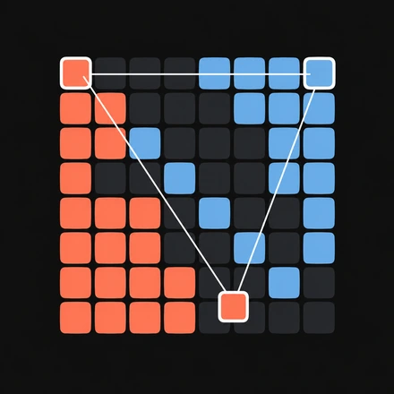

<p align="center">
  
</p>

# MAM-Bench

**Compare language models by how well their agent groups steer multi-agent simulations.**

Each simulation creates 16 separate model controlled agents challenged to understand the simulation's rules,
cooperatively plan toward a goal, coordinate through a shared message board, and execute
their strategy. MAM-Bench measures the resulting change in ordinary-agent outcomes
against a paired, rule-based world. Run the same suite with different models to
compare their ability to steer a complex system toward a predefined goal.

[](https://github.com/JoeHelbing/mam-bench/actions/workflows/ci.yml)
[](https://github.com/JoeHelbing/mam-bench/releases/latest)
[](LICENSE)

[How it works](#how-it-works) | [Quickstart](#quickstart) |
[Custom suites](docs/custom-test-suite.md) | [Reference](#reference)

> [!IMPORTANT]
> **Research-stage benchmark.** The suite, interfaces, and scoring may change.

The [project overview](https://joehelbing.net/post/mam-bench) introduces the idea.

## How it works

Each case runs one selected model in a group of agents with a specific goal.
The two worlds start with the same seed and settings:

```text
                    one case + one seed
                   /                   \
    ordinary world                     controlled world
    all agents follow rules             selected agents use the model
                   \                   /
           compare ordinary-agent outcomes
                         v
                signed case score
```

The model-controlled agents can coordinate, but the score comes from their
*effect on the ordinary agents*, not from judging their conversations. The
shipped suite contains six cases in three matched-seed goal pairs:

| Simulation | Goal pair | Measured outcome |
| --- | --- | --- |
| Schelling (2 cases) | Integration / segregation | Final ordinary-agent neighbor homophily |
| Civil Violence, citizen control (2 cases) | Increase / decrease participation | Ordinary-citizen participation and revolution |
| Civil Violence, police control (2 cases) | Increase / decrease participation | The same ordinary-citizen outcomes |

Each case produces a signed score, plus the score of a null-policy world in
which the model never acts. The **Combined Benchmark Score** sums every case's
adjusted score (score minus null-policy score; six cases in the shipped suite),
including negative ones, so never acting is worth exactly zero. A model that
cannot act, however, does not get that zero: a run in which more than 10% of
model turns fall back fails with no score. One invocation
evaluates **one model**; compare totals only when the suite and scoring version
are identical.
Model responses and resulting trajectories can still vary between runs. See
[rules and scoring](docs/rules-and-scoring.md) for the exact formulas and world
mechanics.

## Quickstart

You need [uv](https://docs.astral.sh/uv/), Python 3.14, and access to a model
service that supports tool calls. For direct API access, follow the
[OpenAI benchmark guide](docs/native-openai.md) or
[Anthropic benchmark guide](docs/native-anthropic.md). The quickstart below uses
vLLM; an OpenRouter example follows it. Bring your own model and endpoint.

```bash
git clone https://github.com/JoeHelbing/mam-bench.git
cd mam-bench
uv python install 3.14.7
uv sync --frozen
```

For an evaluation, create `.scratch/model.yaml` (run `mkdir -p .scratch` first).
The directory is Git-ignored. Replace the placeholders with a real model ID and
endpoint; do not put credentials in YAML:

```yaml
runtime: vllm
model: YOUR_MODEL_ID
base_url: https://YOUR-ENDPOINT.example/v1
```

Evaluations also require Modal credentials. Set `MODAL_TOKEN_ID` and
`MODAL_TOKEN_SECRET` in the environment or this project's Git-ignored `.env`;
see [.env.example](.env.example). MAM-Bench loads these on the host, without
passing them into the agents' environments.

Each controlled agent gets a private Modal sandbox for its simulation case.
The default suite creates 16 sandboxes in each of six sequential cases, 96 in
total. Case completion, failure, and cancellation trigger explicit cleanup.
`settings.sandbox_timeout_seconds` defaults to 43,200 (12 hours) as a lifetime
backstop; choose a longer value, up to 86,400, if one case needs more time.
Sandbox startup is separate from the model-turn timeout.

The shared custom image includes Python 3.14, NumPy 2.5.2, git, ripgrep, and
util-linux. Coder supplies file tools and a shell, with subagents and repository
context disabled. Agents retain their own workspace files between turns and
can create notes or scripts. `observe()` returns their local observation;
Python code can use `from observe import observe` to read the same snapshot.
Each turn refreshes `observation.json`.

Use the actual served model ID so PydanticAI's `VLLMProvider` can select its
model-family profile. It handles reasoning, tool schemas, and system-message
formatting. `settings.reasoning_effort` is sent verbatim as the runtime's native effort
(`none` disables thinking); the provider, not MAM-Bench, decides whether it is valid.
Omitted sampling and reasoning settings use endpoint defaults, including for
history summaries. Action and summary output caps default to one quarter of the
discovered serving context, bounded by any reported provider output limit. For
a 262,144-token context, the default is 65,536 output tokens per request. Override
these with `settings.max_completion_tokens` and `settings.summary_completion_tokens`
in the model YAML. MAM-Bench does not add a model-request seed; case seeds still
control simulation randomness. Put desired request overrides under `settings`.
`tool_choice: required` retains native fallback when a profile cannot force
tools; `tool_choice: auto` opts out of forcing while keeping terminal actions.

For local vLLM builds supporting repeated-pattern detection, add this at the
top level of the model YAML for future runs:

```yaml
repetition_detection:
  min_pattern_size: 16
  max_pattern_size: 128
  min_count: 8
```

This stops consecutive repeated token patterns early; it does not change token
probabilities. The policy applies to agent and summary requests and is retained
in the run configuration. Omit it, or use `repetition_detection: null`, for a
baseline or a server without this vLLM extension. The adapter retains a native
repetition stop in provider details and uses bounded incomplete-output handling.
These thresholds are an initial policy, not a measured optimum.

For vLLM endpoints that require authentication, set `VLLM_API_KEY` in `.env`
or the environment. Otherwise, leave it unset.

Run the shipped suite:

```bash
uv run --no-sync main.py --model .scratch/model.yaml --output results/default
```

**This makes real model requests and can incur substantial charges.** Check
endpoint support, data-use terms, and pricing before running all six cases.
Each invocation creates a new output directory and does not overwrite a
previous run. See [artifacts and failures](docs/artifacts-and-failures.md) for the saved records and failure behavior.

An incomplete run, such as one stopped by a persistent provider error, can be
resumed. Only its unfinished cases run again, in the same directory:

```bash
uv run --no-sync main.py --resume results/default/<run-directory>
```

Each CLI run uses Pydantic AI's `Agent.instrument_all()` to capture agent
conversations, reasoning, tool calls/results, and usage. OpenTelemetry writes
traces, logs, and metrics to `<run-directory>/telemetry/` under `--output`.
Set `LOGFIRE_TOKEN` in `.env` or the environment to also send this telemetry
to Logfire.

You can replace the six cases with a YAML suite of your own:

```bash
uv run --no-sync main.py --model .scratch/model.yaml \
  --suite path/to/suite.yaml --output results/custom
```

The [custom suite guide](docs/custom-test-suite.md) lists every allowed field.
The shipped cases select `max_steps: 30`; custom cases can choose another
positive integer in either simulation. For OpenRouter, select
`runtime: openrouter` with `model` and `provider` in the model YAML, and set
`OPENROUTER_API_KEY` in the environment or `.env`:

```yaml
runtime: openrouter
model: meta/muse-spark-1.3-contributor
provider: meta
settings:
  reasoning_effort: medium
  tool_choice: auto
```

Meta's live Muse endpoint rejected `required` even though its metadata
advertised support, so this example selects `auto` explicitly. Before the first
case, setup discovers the selected provider's limits from OpenRouter endpoint
metadata or the served vLLM model's `/v1/models` entry. Missing context metadata
stops setup; context limits cannot be supplied in YAML. All selected OpenRouter
routes must report context; the smallest context/prompt ceiling applies when
routes differ. Larger served context remains available to the benchmark.

Setup rejects request overrides that violate known constraints. Unknown parameter
capabilities are left to the native provider and endpoint. Omitted generation
settings remain unset; setup does not invent output reservations or silently
reduce requested limits. Compaction, retained history, sandbox lifetime, concurrency, and
timeouts remain benchmark settings. Compaction uses the discovered context and
the configured trigger fraction (default 70%); token estimates and unknown
endpoint output defaults cannot guarantee that every request fits.
Direct library callers supply discovered context separately to `CaseRuntime`
and `AgentSessions`.

PydanticAI owns model-specific reasoning, tool safeguards, and prompt-cache
breakpoints. MAM-Bench enables its native OpenRouter instruction, message, and
tool caching controls; native profiles handle supported hints. Native telemetry
records reported cache usage; hints never guarantee a hit. The run saves requested
settings and discovered serving facts separately; unreported endpoint defaults
remain unknown. See [config.py](src/mam_bench/config.py) and
[model_setup.py](src/mam_bench/model_setup.py). If you use mise,
`mise install` and `mise run setup` prepare the pinned project tools and
dependencies.

## Reference

- [Anthropic benchmark guide](docs/native-anthropic.md) - configure a model and run the full suite.
- [OpenAI benchmark guide](docs/native-openai.md) - configure a model and run the full suite.
- [Rules and scoring](docs/rules-and-scoring.md) - world mechanics, goals, formulas,
  and comparability limits.
- [Artifacts and failures](docs/artifacts-and-failures.md) - trajectories,
  messages, partial results, retries, and sensitive output.
- [Architecture and source walkthrough](docs/architecture.md) - where the
  runner, simulations, sessions, and persistence live.
- [Custom test suite YAML](docs/custom-test-suite.md) - fields and validation
  for explicit test cases.

See [CONTRIBUTING.md](CONTRIBUTING.md) for changes and bug reports,
[CHANGELOG.md](CHANGELOG.md) for releases, and [LICENSE](LICENSE) for Apache-2.0.
